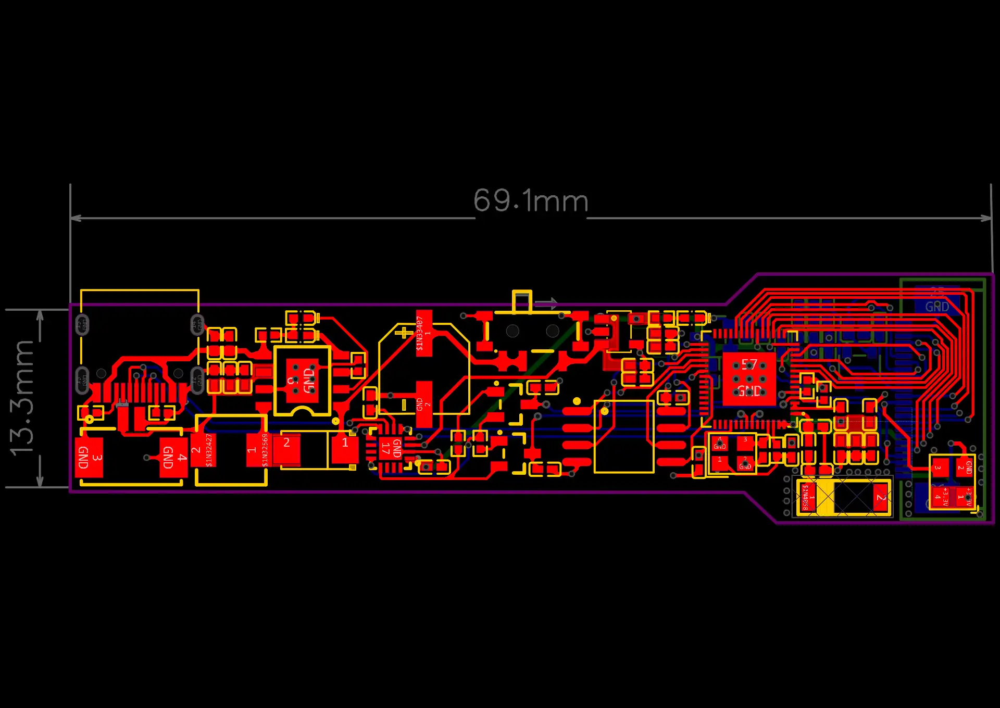
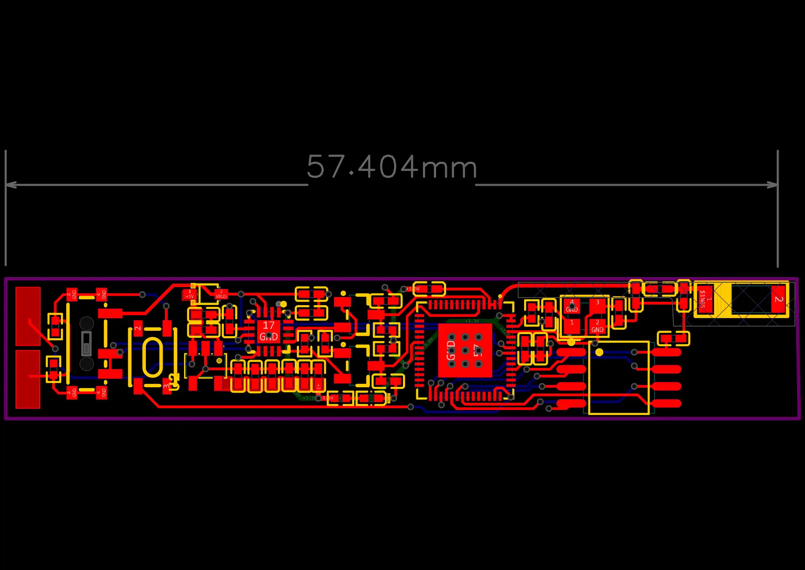

# EmbodiedWhisper

Open hardware and a Python SDK for a modular glasses-and-ring platform. The glasses
combine host-connected eye imaging with an ESP32-S3 scene-camera interface; the ring
provides BLE button events for controlling an application.

| Glasses PCB | Ring PCB |
| --- | --- |
|  |  |

## Repository contents

| Directory | Contents |
| --- | --- |
| [hardware/design](hardware/design) | Editable schematics and both PCB layouts in one EasyEDA Pro project |
| [hardware/glasses](hardware/glasses) | Glasses Gerber/drill exports, component BOM and layout preview |
| [hardware/ring](hardware/ring) | Ring Gerber/drill exports, component BOM and schematic/layout previews |
| [firmware/glasses](firmware/glasses) | ESP32-S3 Wi-Fi JPEG streaming firmware and camera pin map |
| [firmware/ring](firmware/ring) | ESP32-S3 button detection and BLE firmware |
| [sdk](sdk) | Python BLE, USB capture, pupil recording, reflex filtering and RIPA trigger interfaces |
| [tools](tools) | TCP camera viewer and receiver |
| [examples](examples) | Device examples and a synthetic pupil-stream example |
| [docs](docs) | Build instructions, interfaces and release scope |

## Quick start

Use Python 3.10 or later. Run from the repository root:

```sh
python -m pip install ./sdk
python examples/synthetic_pupil_stream.py
```

For cameras, BLE and ONNX inference:

```sh
python -m pip install "./sdk[hardware]"
python examples/ring_events.py --help
python examples/record_eye.py --help
python tools/view_tcp_stream.py --help
```

The synthetic example runs without a device. The scene-camera receiver listens on
the host; configure the glasses firmware with that host's LAN address before use.
See [Build and run](docs/BUILD_AND_RUN.md) and [Interfaces](docs/INTERFACES.md).

## Hardware and firmware

Open [EmbodiedWhisper.epro2](hardware/design/EmbodiedWhisper.epro2) in EasyEDA Pro
to inspect or edit the two boards. Manufacturing exports are provided separately
for each board. Check the assembly orientation, component variants and camera pin
map against the editable design before fabrication.

Both firmware projects target ESP32-S3; the intended environment is ESP-IDF 5.4.3. Network
settings are entered locally with `idf.py menuconfig`; no preset network credentials
are included. The camera driver is obtained from its public upstream dependency.

This release includes hardware design files, firmware and host interfaces. It does
not include trained detector weights, participant recordings or a complete hosted
assistant application. The eye recorder's detector interface is described in the
build guide. See [Release status](docs/RELEASE_STATUS.md) for validation limits.

## License

Project files use the root [MIT license](LICENSE). External dependencies and embedded
component-library assets retain their respective terms; see [Licensing](docs/LICENSING_STATUS.md).
